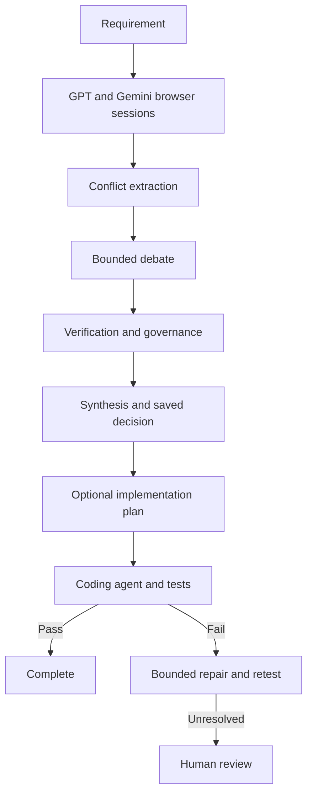

# Sol0mon

**An experimental multi-agent AI engineering system for research, architectural decisions, verification, and AI-assisted implementation.**

Sol0mon explores how to handle important technical decisions when AI systems produce plausible but conflicting answers. It coordinates separate model responses, identifies disagreements, debates unresolved choices, verifies claims, records decisions, and can carry them into an optional build-and-test workflow.

Sol0mon is free to run and does not charge a usage fee. The current debate uses the ChatGPT and Gemini websites through browser sessions, so you need accounts with access to those services. Verification can use a configured API provider or local Ollama; API usage may cost extra. Provider access and charges are not included.

> Sol0mon does not guarantee that its decisions or generated code are correct. Human review is required. This project has not selected a software license yet, so it is not yet released under an open-source license.

## What it does

```text
Requirement
    ↓
Research and separate model responses
    ↓
Extract disagreements
    ↓
Debate and verify disputed choices
    ↓
Govern a decision or ask for human input
    ↓
Synthesize and save the result
    ↓
Optional: plan, build, test, and repair
```

Instead of treating one model response as final, Sol0mon makes disagreements and decisions visible and saves workflow state so work can be resumed.

## How it works

1. You submit a question or project goal in the CLI.
2. ChatGPT and Gemini respond in separate browser sessions.
3. Sol0mon extracts disagreements and runs bounded debate rounds.
4. A configured verification provider checks disputed claims. Governance records a decision, a trade-off, or a request for human input.
5. Sol0mon synthesizes the result and saves it to local memory and a workspace.
6. For implementation work, the optional build flow creates a specification, calls a coding agent, runs tests, and can attempt bounded repairs.

The current debate uses the ChatGPT and Gemini websites, not their APIs. Verification uses a separate configured provider: Cerebras, Groq, OpenRouter, or local Ollama.



## Main ideas

- **Separate reasoning:** models form their own positions before debating.
- **Explicit disputes:** disagreements are tracked individually instead of repeatedly regenerating whole answers.
- **Verification and governance:** outcomes can be a verified decision, a verified trade-off, or a request for human input.
- **Bounded debate:** the current default consensus threshold is 92%, with a limit on debate rounds. These settings do not measure factual accuracy.
- **Persistent state:** answers, decisions, and workflow state are stored locally for review and continuation.
- **Optional implementation:** saved decisions can feed a coding-agent workflow with tests and a bounded repair path.

## Architecture

| Component | Role |
| --- | --- |
| `chat_session.py`, `gpt_worker.py`, `gemini_worker.py` | Connect to the ChatGPT and Gemini websites through a persistent browser session. |
| `debate_engine.py`, `conflict_extractor.py` | Extract disagreements and coordinate debate rounds. |
| `provider_router.py`, `*_client.py` | Route verification and related generation requests to configured providers. |
| `verification_engine.py`, `governance.py` | Check claims and record decisions, trade-offs, or human escalation. |
| `synthesis_engine.py`, `decision_renderer.py` | Synthesize results using model output and structured decision data. |
| `pipeline_runner.py`, `workflow_orchestrator.py` | Coordinate pipeline stages. |
| `workspace_manager.py`, `answer_memory.py` | Persist answers and workspace state locally. |
| `sol0mon_cli.py` | Provide the command-line interface. |

## Requirements

- Python 3.12 (the version represented by the supplied environment; other versions have not been verified).
- Chrome or Chromium for browser-based ChatGPT and Gemini sessions.
- Accounts with access to the ChatGPT and Gemini websites.
- A verification provider key in `.env`, or a local Ollama server.
- Optional coding-agent CLI for implementation workflows.

## Install

Clone the repository and run these commands from its directory.

### Windows PowerShell

```powershell
py -3.12 -m venv .venv
.\.venv\Scripts\Activate.ps1
python -m pip install -r requirements.txt
Copy-Item .env.example .env
```

### Linux

```bash
python3.12 -m venv .venv
source .venv/bin/activate
python -m pip install -r requirements.txt
cp .env.example .env
```

Add only the API key for the verification provider you plan to use. Never commit `.env`.

### Start the browser

Sol0mon connects to Chrome on port `9222`. Use a separate profile for Sol0mon, then sign in to ChatGPT and Gemini in that browser. Do not put the profile inside the repository; it contains login sessions.

**Windows PowerShell** (adjust the Chrome path if needed):

```powershell
$chrome = "$env:ProgramFiles\Google\Chrome\Application\chrome.exe"
& $chrome --remote-debugging-port=9222 --user-data-dir="$env:LOCALAPPDATA\Sol0mon\Chrome" https://chatgpt.com https://gemini.google.com/app
```

**Linux**:

```bash
google-chrome --remote-debugging-port=9222 --user-data-dir="$HOME/.sol0mon-chrome" https://chatgpt.com https://gemini.google.com/app
```

If your browser command is `chrome` or `chromium`, use that instead.

## Run

```bash
python sol0mon_cli.py --help
python sol0mon_cli.py debate "Compare two approaches to this problem"
python sol0mon_cli.py status
```

The CLI also provides `build` and `resume` commands; use `--help` to see their arguments.

## Test

Run the offline warm-up check:

```bash
python -B tests/test_debate_warmup.py
```

Run the broader test driver with:

```bash
python run_all_tests.py
```

Some tests require external tools or services. Review the output for skipped or failed tests.

## Project structure

- Python modules at the repository root: pipeline, debate, verification, providers, memory, and CLI.
- `coding_agents/`: coding-agent adapters.
- `docs/`: architecture and engineering notes.
- `tests/` and root-level test files: automated checks.
- `prompts/`: prompt material.
- `workspaces/`, databases, and logs: local runtime data; do not commit them.

## Limitations

- Browser-based debate depends on changes to the ChatGPT and Gemini websites and requires an authenticated browser session.
- Verification depends on the configured provider or local Ollama being available.
- Multi-stage model workflows can take longer and use more inference than a single response.
- Verification and consensus do not guarantee that claims or generated software are correct.
- The full external-service workflow has not been freshly revalidated in the original remote environment.

## Future plans

Planned work includes adding Claude as a third debate participant. A separate API-based mode using Gemini, ChatGPT, and Claude is also planned if there is enough demand. These are future plans; the current debate path uses the ChatGPT and Gemini websites.

## Contributing and security

See [CONTRIBUTING.md](CONTRIBUTING.md) before making changes and [SECURITY.md](SECURITY.md) to report a vulnerability. Keep credentials, browser profiles, databases, logs, and private workspace data out of commits and public issues.

## License

No license has been selected or added. Until a license is chosen, the repository is not yet released under an open-source license.
